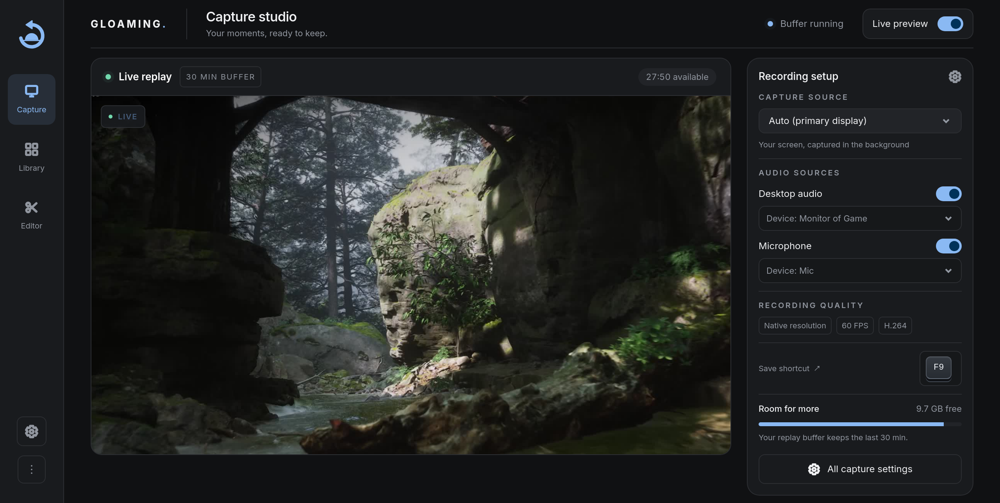

<p align="center">
  
</p>

<p align="center">
  <b>Instant-replay game clipping for Linux.</b><br/>
  Press one key to save the last 20 seconds of gameplay. No scenes, no setup, no upload.
</p>

<p align="center">
  <a href="https://viceclipper.framer.website/">Website</a> ·
  <a href="#install">Install</a> ·
  <a href="#features">Features</a> ·
  <a href="#configuration">Config</a> ·
  <a href="#troubleshooting">Troubleshooting</a>
</p>

<table align="center">
  <tr>
    <td align="center" width="50%">
      <br/>
      <sub>Home: recent clips, playlists, and quick toggles</sub>
    </td>
    <td align="center" width="50%">
      <br/>
      <sub>Editor: multi-track timeline with clips, text, and audio</sub>
    </td>
  </tr>
  <tr>
    <td align="center" width="50%">
      <br/>
      <sub>Settings, in any of five accents</sub>
    </td>
    <td align="center" width="50%">
      <br/>
      <sub>Trim a clip in place, no re-encode needed</sub>
    </td>
  </tr>
</table>

---

## Install

**Arch / Manjaro / CachyOS / any Arch-based distro:**

```bash
yay -S gloaming-clipper     # or: paru -S gloaming-clipper
systemctl --user enable --now gloaming.service
```

The package ships the service but does not enable it for you, so run that second line to have clipping start at login. `./install.sh` asks and does it for you.

**NixOS (flake):**

```nix
{
  inputs.gloaming.url = "github:splitshotz/Vice";

  outputs = { nixpkgs, gloaming, ... }: {
    nixosConfigurations.yourhost = nixpkgs.lib.nixosSystem {
      modules = [ gloaming.nixosModules.default { services.gloaming.enable = true; } ];
    };
  };
}
```

The module installs the package, the `uaccess` udev rule for the hotkey listener, gpu-screen-recorder's capability wrapper so recording starts without a password prompt, and the user daemon, which starts with your graphical session. Set `services.gloaming.autoStart = false;` to only record while the window is open. Without flakes, `nix/package.nix` and `nix/module.nix` are plain callPackage/NixOS files you can import directly.

**Ubuntu / Debian / Mint / Fedora / openSUSE / other:**

```bash
git clone https://github.com/splitshotz/Vice && cd Vice && ./install.sh
```

Launch **Gloaming** from your app menu (or run `gloaming-app`) and press **F9** in a game. If the terminal says `gloaming: command not found`, restart the terminal first.

The AUR package and the script install everything Gloaming needs, including the `gpu-screen-recorder` capture backend and a systemd user service so clipping starts at login. The script detects your package manager (`apt`, `dnf`, `pacman`, `zypper`) automatically.

| | Update | Uninstall |
|---|---|---|
| AUR | `yay -Syu` | `sudo pacman -Rns gloaming-clipper` |
| Git clone | `cd Vice && git pull && ./install.sh` | `gloaming uninstall && rm -rf Vice` |
| NixOS | `nix flake update gloaming && sudo nixos-rebuild switch` | Remove `services.gloaming.enable` and rebuild |

> Don't mix the AUR package and `./install.sh` on the same machine. Uninstall one before switching.

**Bazzite / Fedora Atomic:** not supported yet. rpm-ostree systems can't use `install.sh`, and the installer exits early on them rather than breaking your system. A Flatpak will fix this; follow [#97](https://github.com/splitshotz/Vice/issues/97).

---

## Features

**Free and open source.** No account, no subscription, no telemetry. Read the code, change it, ship your own build.

**Share links that just work.** Every clip gets a public URL the moment you save it, no upload step, no size limit. Paste it into Discord and it plays inline as an embed, tinted to match your theme color.

**A real timeline editor, built in.** Multiple video and audio tracks, transitions, and text overlays, all free and included. Trim, arrange, and layer clips into something bigger without leaving Gloaming.

**Playlists.** Clips file themselves into a playlist for whatever game you were playing, automatically. Make your own for anything else, and drag clips between them.

**Driver-level capture.** Gloaming runs on `gpu-screen-recorder`, the same approach ShadowPlay uses: it talks to NVENC/VAAPI directly instead of compositing a scene. Typical CPU usage is under 1%, and it works on NVIDIA, AMD, and Intel, on every major compositor.

**Discord Rich Presence.** Shows what game you're clipping right in your Discord status, on by default for known games.

**Clips titled for you.** Gloaming recognizes the game you're playing from a curated list and names the file accordingly, no guessing from window titles.

**Hotkeys per clip.** Add your own rename-able, color-coded hotkeys to any clip for quick recall later.

**Gloaming Sessions.** Double-tap your clip key to start recording a full match. Single-tap during the session to drop a marker at that moment, then pick up right where you left off once it lands in the editor.

**Clips the screen you're on.** Turn on Follow my mouse and Gloaming records whichever monitor the pointer is sitting on, instead of one you picked in advance. Works on X11, Hyprland and Sway.

**Your keys on screen.** A keyboard overlay shows the keys you press over your game, for streams and clips, in your theme colour. Drag it anywhere or pick a corner. Gloaming can also keep the keys with each clip to show in the viewer or burn into an editor export. Off until you turn it on; only the overlay's own keys are ever read. Needs X11, or a Wayland desktop with layer-shell (KDE Plasma, Hyprland, Sway, Niri).

**Stays out of the way.** List the apps that clip on their own keys and Gloaming ignores its hotkeys while they are focused.

**Tune it to taste.** Custom `gpu-screen-recorder` flags and arguments, 8-bit or 10-bit colour, color themes, and fully rebindable hotkeys, all from Settings.

## Using Gloaming

| Key / Action | What happens |
|---|---|
| **F9** | Save the last 20 s |
| **Extra clip keys** | Save their own duration, e.g. F6 for 60 s (Settings → Hotkeys) |
| **Key combos** | Rebind to a modifier combo like **Alt + F9** (Settings → Hotkeys) |
| **F9 · F9** (double-tap) | Start / stop a session recording |
| **F9** during a session | Drop a highlight at this moment |
| **Click a thumbnail** | Open viewer · ← → next/prev · **H** new highlight · **Esc** close |
| **Share** | Copy the public URL (pastes into Discord as a playable embed) |
| **Trim** | Drag handles to crop a clip in place |

Clips live in `~/Videos/Gloaming/`. Closing the window keeps the daemon recording; reopen from your launcher any time.

## Why Gloaming?

OBS has a replay buffer. So why use Gloaming?

|  | OBS Replay Buffer | Gloaming |
|---|---|---|
| **Setup time** | Launch OBS, build a scene, enable the buffer, bind a hotkey | Install, press F9 |
| **Always on** | OBS must stay open with a scene active | Silent daemon, always watching |
| **GPU overhead** | Encodes a composed scene continuously | Captures the compositor framebuffer directly. Near zero. |
| **Global hotkey** | OBS must be focused (or use a plugin) | Reads evdev; works on every compositor |
| **Sharing** | Manual upload | Built-in public URL, Discord auto-embed |
| **Clip management** | None | Gallery, viewer, trim, highlights, rename |

## Compatibility

| Compositor / Shell | | GPU | |
|---|---|---|---|
| Hyprland (Wayland) | ✅ | NVIDIA | ✅ NVENC |
| GNOME (Wayland) | ✅ | AMD / Intel | ✅ VAAPI |
| KDE Plasma (Wayland) | ✅ | Anything else | ✅ libx264 software fallback |
| sway (Wayland) | ✅ | | |
| Niri (Wayland) | ✅ | | |
| Any X11 WM | ✅ | | |

`gpu-screen-recorder` is the default backend everywhere. Gloaming can also run the Flatpak build (`com.dec05eba.gpu_screen_recorder`), which carries its own FFmpeg and keeps recording on the GPU on older NVIDIA cards; it is used when it is the only one installed, or when chosen in Settings. `wf-recorder` (Wayland) and `ffmpeg x11grab` (X11) exist as explicit opt-ins via `recording.backend` for unusual setups; they are never auto-selected.

Game detection (filename tagging and Discord presence) works on X11, Hyprland, sway and Niri. Works on KDE Plasma Wayland when `kdotool` is available. On other compositors clips simply save untagged.

## CLI

```
gloaming start          Start the recording daemon
gloaming start --no-open-ui
                    Start the daemon without opening the browser UI
gloaming stop           Stop the daemon
gloaming clip           Save a clip right now
gloaming status         Show daemon status, backend, and share URL
gloaming ui             Open the web UI in your browser
gloaming clips          List saved clips
gloaming config         Print current config
gloaming open-config    Open config in $EDITOR
gloaming list-keys      Show valid hotkey names (KEY_F9, KEY_INSERT, …)
gloaming doctor         Run startup diagnostics
gloaming uninstall      Remove Gloaming cleanly
```

The systemd user service created by the installer runs `gloaming start --no-open-ui`, so Gloaming clips at login without opening a window. Custom systemd/Nix units can use the same command.

## Configuration

Gloaming writes `~/.config/gloaming/config.toml` on first run. Everything below is also editable live from the GUI.

```toml
[recording]
buffer_duration = 120     # seconds kept in the rolling buffer
clip_duration   = 20      # seconds saved per clip
fps             = 60
display         = "DP-1"  # optional; omit to use the backend default display
follow_mouse_display = false # record whichever monitor the pointer is on, ignoring `display`
encoder         = "auto"  # auto | h264_nvenc | hevc_nvenc | h264_vaapi | hevc_vaapi | libx264 | libx265
color_depth     = "8"     # 8 | 10 (10-bit needs an HEVC or AV1 encoder)
backend         = "auto"  # auto | gsr | wf-recorder | ffmpeg
container       = "mp4"   # mp4 | mkv (mkv is crash-safe; Discord embeds need mp4)
capture_audio   = true
capture_microphone = false
microphone_source = "default_input" # default_input | device:name; which mic to capture
gsr_audio_source = "default_output" # default_output | device:name | app:name | app-inverse:name
audio_tracks    = []      # separate tracks instead of a mix, e.g. ["default_output", "default_input", "app:Discord"]
audio_tracks_mix_first = false # also record a track 1 that mixes every source
gsr_args        = ""      # extra gpu-screen-recorder flags, e.g. "-k hevc -bm cbr -q 20000"

[hotkeys]
clip = "KEY_F9"
disable_while_focused = []  # e.g. ["ggst.exe"] to leave the keys to a game that clips itself

[[hotkeys.clip_presets]]
key = "KEY_F6"
duration = 60

[[hotkeys.clip_presets]]
key = "KEY_F7"
duration = 120

[output]
directory = "~/Videos/Gloaming"
tag_clips_with_game   = true  # Clip_2026-10-25_21-30-45_Overwatch-2.mp4 when a known game is focused
auto_playlist_by_game = true  # file each clip into a per-game playlist
clip_name_template    = ""    # optional: e.g. "clip_$date_$time"; empty keeps default naming

[sharing]
enabled           = true
port              = 8765  # local control UI (always 127.0.0.1)
public_port       = 8766  # public share-only server (defaults to port + 1)
cloudflare_tunnel = true
base_url          = ""    # optional public origin override (reverse proxy / custom domain)

[discord]
enabled            = true   # shows Rich Presence when a known/custom game is focused
client_id_override = ""     # leave blank to use Gloaming's default Discord app
# Add custom games via Settings → Discord. Each line is "Display Name | match1, match2".

[updates]
check_on_start = true   # ask GitHub once a day whether a newer release exists

[notifications]
sound_volume = 1.0   # clip and session tones, 0.0 to 1.0. 0 plays nothing
```

Notes:

- `notifications.sound_volume` controls the ping when a clip is saved and the session start, stop and highlight tones. Set it to 0, or slide it to Off in Settings → Audio, and Gloaming plays nothing at all rather than playing silence.

- `updates.check_on_start` asks the GitHub releases API at most once a day whether a newer Gloaming is out, and shows a notice with a few lines from the release notes when there is. Nothing about you or your clips is sent, the notice appears once per release and leaves only a small chip in the top bar after you dismiss it, and a failed check is silent. Turn it off in Settings → Advanced, or with this key.

- `recording.audio_tracks` records each listed source as its own audio track, in order. Browsers and Discord play only track 1; video editors see all of them. Tracks can be reordered from Settings → Recording. With mic capture on, the microphone is added as its own track. `audio_tracks_mix_first` adds an extra track 1 that mixes every source, so shared clips carry full audio. `container` and `audio_tracks` apply to the gpu-screen-recorder backend; wf-recorder/ffmpeg clips stay single-track MP4.
- `recording.microphone_source` picks which microphone the mic toggle captures. `default_input` follows the system default; `device:<name>` pins a specific input without changing your system setting.
- `recording.gsr_args` supports environment/tilde expansion and a `{default_sink_monitor}` placeholder for desktop-audio capture.
- With the gpu-screen-recorder backend, `recording.encoder` also accepts `h264_vulkan`, `hevc_vulkan`, and `av1_vulkan`. Auto uses an available Vulkan encoder when GSR reports none of its usual hardware codecs. Other systems keep GSR's normal selection. Vulkan encoding requires support from GSR, FFmpeg, and the GPU driver.

## Troubleshooting

**`gloaming: command not found` after install.** Restart your terminal, or run `exec $SHELL` (fish: `exec fish`).

**App launcher icon does nothing.** Check `~/.local/share/gloaming/gloaming-app.log`. Most common cause: `gpu-screen-recorder` is missing from PATH. If the log mentions `autoaudiosink not found`, install your distro's GStreamer base/good plugin packages.

**Hotkey not firing.** Add yourself to the `input` group:
```bash
sudo usermod -aG input $USER && newgrp input
```

**Hotkey stopped after unplugging the keyboard.** Fixed in v1.2.0; Gloaming reattaches within a few seconds of replugging. Update if you're on an older version.

**Daemon can't find the Wayland session when started by systemd or the app launcher.** On Hyprland/Sway, the systemd user instance often doesn't inherit `WAYLAND_DISPLAY` from the compositor. Add to your compositor config:

Hyprland (`~/.config/hypr/hyprland.conf`):
```
exec-once = systemctl --user import-environment WAYLAND_DISPLAY DISPLAY DBUS_SESSION_BUS_ADDRESS XDG_RUNTIME_DIR XDG_SESSION_TYPE XDG_CURRENT_DESKTOP
exec-once = dbus-update-activation-environment --systemd WAYLAND_DISPLAY DISPLAY DBUS_SESSION_BUS_ADDRESS XDG_CURRENT_DESKTOP
```

Sway (`~/.config/sway/config`):
```
exec systemctl --user import-environment WAYLAND_DISPLAY DISPLAY DBUS_SESSION_BUS_ADDRESS XDG_RUNTIME_DIR XDG_SESSION_TYPE XDG_CURRENT_DESKTOP
exec dbus-update-activation-environment --systemd WAYLAND_DISPLAY DISPLAY DBUS_SESSION_BUS_ADDRESS XDG_CURRENT_DESKTOP
```

Restart your compositor session, then `systemctl --user restart gloaming.service`.

**Share link only works on my local network.** Enable the tunnel in Settings → Sharing and make sure `cloudflared` is installed. cloudflared is the only supported tunnel; if it's missing, Gloaming shows an error in the UI instead of generating a broken link.

**Clip won't embed on Discord.** Discord only inlines videos up to about 50 MB; trim the clip or lower CRF/resolution. Links also stop working when the Gloaming daemon restarts, since a fresh tunnel URL is generated each run; repost the link after a restart. MKV clips don't embed; use the default MP4 container for sharing.

**Clips show a grey box inside Gloaming but play fine in other apps.** The Qt WebEngine build Gloaming is running has no H.264 decoder. This happens when the installer fell back to the PyPI `PyQt6-WebEngine` wheel, which ships without proprietary codecs; distro packages include them. Install the system package, then reinstall Gloaming: `sudo apt install python3-pyqt6.qtwebengine` (Debian/Ubuntu/Mint), `sudo dnf install python3-pyqt6-webengine` (Fedora), `sudo zypper install python3-qt6-webengine` (openSUSE), then `./install.sh` again. Since v1.2.6 the app detects this and says so instead of showing a grey rectangle, and the player offers "Open in system player" as a fallback.

**UI looks like plain unstyled HTML right after an upgrade.** The previous daemon is still running old code in memory. Run `gloaming stop && gloaming-app` once. `gloaming-app` self-heals from the next upgrade onward.

**Native window is laggy.** On NVIDIA, Chromium occasionally fails GPU compositing at launch; Gloaming detects it and relaunches that run in software mode with reduced visual effects. Nothing is remembered, so just close and reopen the window to try the GPU again. `~/.local/share/gloaming/gloaming-app-stderr.log` shows what happened on the last launch. Gloaming prefers QtWebEngine (Chromium, GPU-accelerated) and only falls back to WebKit2GTK if the Qt bindings are missing. Install them: `sudo pacman -S python-pyqt6-webengine` (Arch), `sudo apt install python3-pyqt6.qtwebengine` (Debian/Ubuntu), `sudo dnf install python3-pyqt6-webengine` (Fedora). Then run `gloaming-app`; the log should say `Using QtWebEngine (Chromium) backend`.

**Native window crashes when I click a button.** Reproduce it in debug mode:
```bash
gloaming stop
gloaming-app --debug
# reproduce the crash, then Ctrl+C if the window didn't exit
```
The log lands at `~/.local/share/gloaming/gloaming-debug.log`; attach it to a GitHub issue. Don't pipe the command through `tee`: Chromium's stderr can back up through the pipe and freeze the Qt event loop.

**Anything else.** Run `gloaming doctor` for full diagnostics, or open an issue with the output.

---

## Translating

**Gloaming's interface is one JSON file per language, and adding one is a pull
request.** `ui-src/locales/en.json` is the English source. Every other language
is a copy of it with the values replaced. Nothing else in the codebase has to
be touched.

```bash
npm install                      # once, for the two scripts below
npm run i18n:new -- pt-BR        # writes ui-src/locales/pt-BR.json
npm run i18n:check               # how far along every language is
```

Translate the values, leave the keys alone. Placeholders in braces, like
`{count}` or `{hotkey}`, are filled in at runtime and have to survive into your
sentence; where they sit in it is up to you.

A partly finished translation is worth opening. Fallback is per key, not per
file, so anything you have not reached yet shows in English and everything you
have done shows in your language. There is no point at which it starts working.

Only the interface is translated. Log output, `gloaming doctor` and the CLI stay in
English, so a pasted log means the same thing to everyone reading the issue
tracker.

Anything counted is an object rather than one string, because languages do not
agree on how many forms that needs. Use the CLDR categories your language
actually has: English needs `one` and `other`, Polish needs `one`, `few` and
`many` as well.

```json
"countClips": { "one": "{count} clip", "other": "{count} clips" }
```

Credit goes by handle in the release notes, in the entry for the language, and
in the Credits list below.

[docs/TRANSLATING.md](docs/TRANSLATING.md) has the rest: markup inside a
sentence, testing your file in the running app, and what to do when English
changes under you.

---

## Star History

<a href="https://www.star-history.com/?repos=splitshotz%2Fvice&type=date&legend=top-left">
 <picture>
   <source media="(prefers-color-scheme: dark)" srcset="https://api.star-history.com/chart?repos=splitshotz/gloaming&type=date&theme=dark&legend=top-left" />
   <source media="(prefers-color-scheme: light)" srcset="https://api.star-history.com/chart?repos=splitshotz/gloaming&type=date&legend=top-left" />
   
 </picture>
</a>

## Credits

Created by **Andrew Marin** ([github.com/splitshotz](https://github.com/splitshotz)). Bug reports and PRs welcome.

Gloaming is better because these people sent patches:

- [@Sea-Bass-cmd](https://github.com/Sea-Bass-cmd), for stopping the UI holding on to video and thumbnails it was not showing
- [@SlavWolf](https://github.com/SlavWolf), for fixing session recordings ignoring the configured container, and for Guilty Gear Strive
- [@LiljaGirly](https://github.com/LiljaGirly), for Star Citizen and Trailmakers
- [@NiyuniCidron](https://github.com/NiyuniCidron), for fixing the cloudflared install in the installer
- [@jethrothelion](https://github.com/jethrothelion), for working out why dropdowns were white on white under Plasma, and fixing it
- [@quadruplea0](https://github.com/quadruplea0), for making the resolution setting actually reach gpu-screen-recorder
- [@DeveloperSpoot](https://github.com/DeveloperSpoot), for themed Discord embeds, their idea and their first implementation
- [@jethrothelion](https://github.com/jethrothelion), for Chivalry 2 and Clone Drone in The Danger Zone
- [@voltek-laruelle](https://github.com/voltek-laruelle), for the clip volume slider, the French translation, and for GeoGuessr Steam Edition, Forza Horizon 4, Big Walk, Supermarket Simulator, Sandustry, and OpenFront
- [@20plays](https://github.com/20plays), for system tray support, preserving working Arch installations during installer dependency checks, and selecting the distro Python for QtWebEngine
- [@KITE-Force](https://github.com/KITE-Force), for game detection on KDE Plasma Wayland through kdotool, and for fixing scroll dismissal in clip context menus
- [@UMCEKO](https://github.com/UMCEKO), for the NixOS package and module
- [@marcobabinski](https://github.com/marcobabinski), for the Brazilian Portuguese translation
- [@bryan-ovalle2](https://github.com/bryan-ovalle2), for Game Capture and Discord-sized sharing and exports
- [@suriyahs](https://github.com/suriyahs), for game icons in Discord presence and naming any installed Steam game
- [@MLG993](https://github.com/MLG993), for the German translation

And to everyone who has opened an issue with a log attached: that is most of how the hard bugs get found.

## License

[GPL-3.0](LICENSE)
