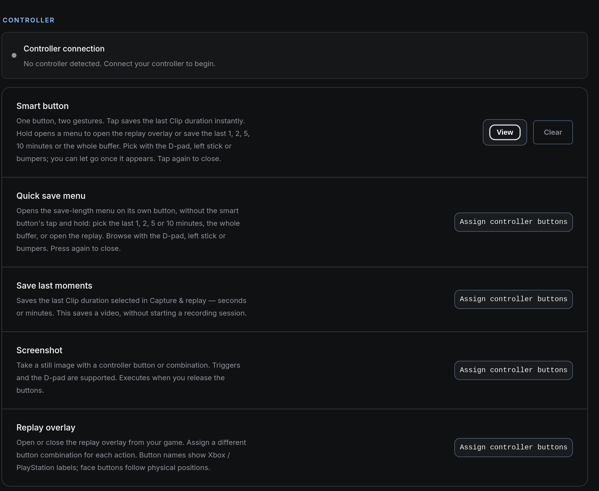
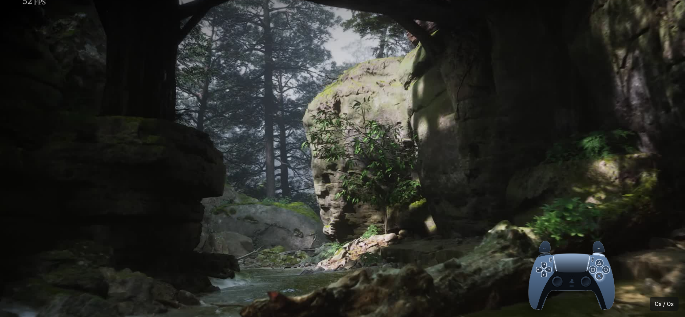
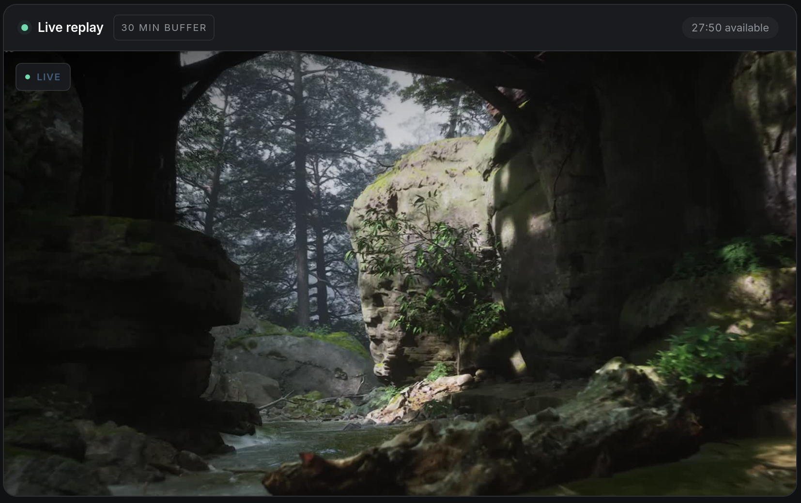
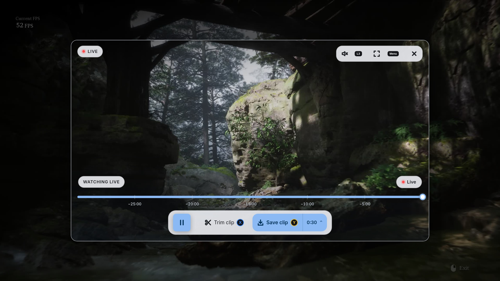
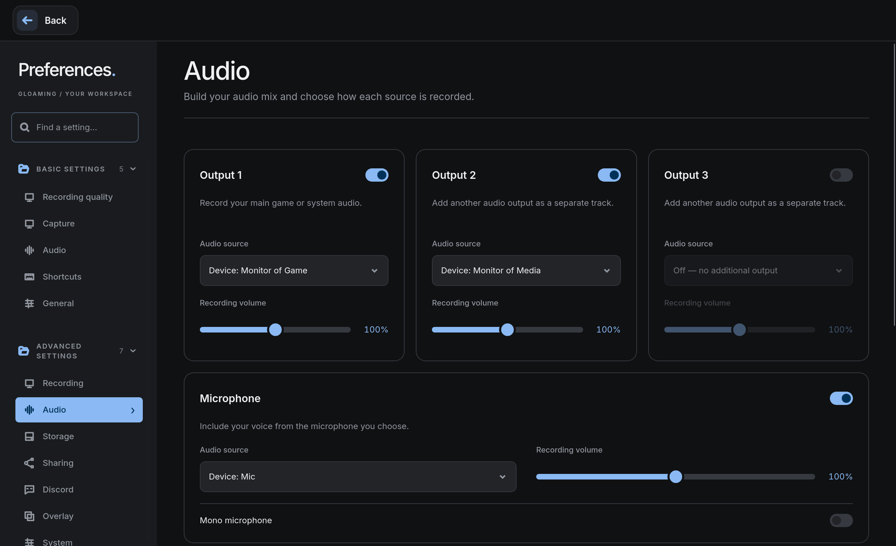
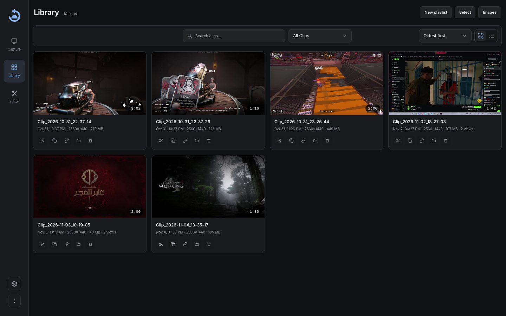
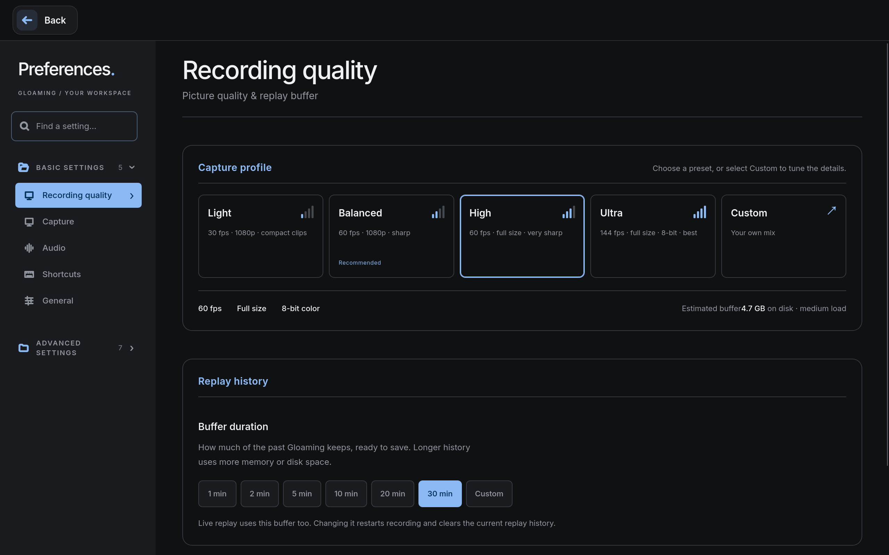

<div align="center">


### Instant replay for Linux games

Press one key and the last 20 seconds of your game become a clip.<br>
No scenes to build, nothing to upload, no account.

<br>


<br>

[Install](#install) &nbsp;·&nbsp; [Controller](#full-controller-support) &nbsp;·&nbsp; [Live replay](#live-replay) &nbsp;·&nbsp; [Audio](#multiple-audio-sources) &nbsp;·&nbsp; [Use it](#use-it) &nbsp;·&nbsp; [Performance](#performance) &nbsp;·&nbsp; [Configuration](#configuration) &nbsp;·&nbsp; [Troubleshooting](#troubleshooting) &nbsp;·&nbsp; [Develop](docs/DEVELOPMENT.md)

<br>

<a href="assets/screenshots/studio.png"></a>

</div>

> [!NOTE]
> Gloaming is built on **[Vice](https://github.com/splitshotz/Vice)** by Andrew Marin and keeps its GPL-3.0 license. See [Credits](#credits).

## How it works

Gloaming runs quietly in the background and keeps a rolling recording of your screen on your GPU's video encoder. When something happens in a game, press **F9**. The moment is saved as an MP4 in `~/Videos/Gloaming/`, with game audio and, if you want it, your microphone.

It records through [`gpu-screen-recorder`](https://git.dec05eba.com/gpu-screen-recorder/about/), so it works on NVIDIA, AMD and Intel, on Wayland and X11.

<table>
  <tr>
    <td width="25%" valign="top"><a href="#full-controller-support"><b>Full controller support</b></a><br><sub>Save, screenshot and replay from the gamepad</sub></td>
    <td width="25%" valign="top"><a href="#live-replay"><b>Live replay</b></a><br><sub>Rewind a game that is still recording</sub></td>
    <td width="25%" valign="top"><a href="#the-replay-overlay"><b>Replay overlay</b></a><br><sub>Review and save over your game</sub></td>
    <td width="25%" valign="top"><a href="#multiple-audio-sources"><b>Multiple audio sources</b></a><br><sub>Game, media, voice chat and mic on separate tracks</sub></td>
  </tr>
</table>

<br>

## Full controller support

You can run Gloaming from the gamepad, with the keyboard and mouse left alone. Controller shortcuts are global: they work while the game has focus, on any compositor.

<a href="assets/screenshots/controller-settings.png"></a>

- **One smart button.** Tap it to save a clip. Hold it to open a menu where you pick the last 1, 2, 5 or 10 minutes, the whole buffer, or open the replay. Choose with the D-pad, left stick or bumpers.
- **Shortcuts for everything.** Give any button or combination (triggers and D-pad included) to saving a clip, taking a screenshot, opening the replay overlay, or opening the quick save menu.
- **Xbox and PlayStation.** The controller type is detected automatically, and buttons carry the right labels and artwork.
- **On-screen controller overlay.** Show the buttons you press over your game, for streams and clips. Choose the style (auto follows the controller you are pressing, or force Xbox or PlayStation), the position and the size, and toggle it with a keyboard shortcut.
- **Inputs saved with each clip.** Keep the controller (and keyboard) inputs beside the footage, show them in the viewer, and include them in an editor export. Both are off by default: turn them on under Settings → Overlay.
- **The replay overlay is controller-driven too.** Trim, save and back out without picking up the mouse.

<a href="assets/screenshots/controller-inputs.png"></a>

<br>

## Live replay

Rewind your game while it is still recording, then save only the part you want.

<a href="assets/screenshots/live-replay.png"></a>

- **Scrub back through the buffer.** The timeline reaches as far back as your replay buffer (up to 30 minutes). **Return to live** jumps back to the newest moment.
- **Pick a range and save it.** Mark a start and an end, then save the selection as an MP4. The video is rewrapped, not re-encoded, so saving is fast. Cuts land on keyframes, normally within about two seconds.
- **No clutter.** Nothing is added to your library until you save.
- **Closing the view does not stop recording.** The temporary history lives only while recording runs.
- **Turn it on** with the Live preview switch on the Capture page. In this mode Gloaming records 8-bit H.264 and AAC, and the preview runs a few seconds behind your screen.

<br>

## The replay overlay

The live replay also opens as a floating player **over your game**, so you can review a moment without alt-tabbing.

<a href="assets/screenshots/replay-overlay.jpg"></a>

- **Open it from anywhere.** **Ctrl + Shift + R** by default, a controller button, or the smart button's hold menu. Press it again, **Esc**, or **B / ○** to close.
- **Rewind, trim, save.** Scrub the timeline, trim the moment, and save it with a length picker, without leaving the game.
- **Mouse, keyboard or controller.** The on-screen hints switch to whichever you used last.
- **Fullscreen** when you want a closer look. The overlay is always dark, so it does not wash out the game.

On GNOME, Gloaming installs a small helper extension by itself the first time it starts, so the overlay can float over fullscreen games. Sign out and back in once to activate it; until then the overlay works through an X11 window.

<br>

## Multiple audio sources

Record your game, your media player, your voice chat and your microphone as **separate tracks** in the same clip.

<a href="assets/screenshots/audio.png"></a>

- **Up to three outputs plus the microphone.** Each has its own source and its own recording volume. The microphone has its own device, level and a mono switch.
- **Pick a device or a single app.** Use any output device, one application such as Discord, or everything except one application.
- **A mixed track for sharing.** Browsers and Discord play only track 1, so a mixed track 1 lets a shared clip carry every source.
- **Fix it afterwards.** In the editor, mute, rebalance or remove any track. The original recording is never changed.
- **Names are kept.** Live replay clips store each source's name inside the MP4, including the microphone and the mixed track.

<br>

## Everything else

<table>
  <tr>
    <td width="50%" valign="top">
      <b>Instant replay</b><br>
      A rolling buffer from 1 to 30 minutes, saved with one key. Extra keys save other lengths, such as F6 for 60 seconds.
    </td>
    <td width="50%" valign="top">
      <b>Sessions</b><br>
      Double-tap the clip key to record a whole match, then tap once to drop a highlight marker at any moment.
    </td>
  </tr>
  <tr>
    <td valign="top">
      <b>Built-in editor</b><br>
      Trim in place, or open a multi-track timeline with transitions and text.
    </td>
    <td valign="top">
      <b>Share links</b><br>
      Copy a link that plays inline when pasted into Discord. A public link needs <code>cloudflared</code>; without it the link works on your network.
    </td>
  </tr>
  <tr>
    <td valign="top">
      <b>Knows your game</b><br>
      Names each clip after the game, files it into that game's playlist, and can show it in Discord Rich Presence.
    </td>
    <td valign="top">
      <b>Screenshots</b><br>
      Take a still with a keyboard or controller shortcut, saved beside your clips.
    </td>
  </tr>
</table>

**Private by design.** No account and no telemetry. Clips stay on your disk until you choose to share one.

<table>
  <tr>
    <td width="50%"><a href="assets/screenshots/library.png"></a></td>
    <td width="50%"><a href="assets/screenshots/settings.png"></a></td>
  </tr>
  <tr>
    <td align="center"><sub><b>Library</b>: every clip, searchable, with trim, share and delete</sub></td>
    <td align="center"><sub><b>Settings</b>: pick a capture profile and set the replay buffer</sub></td>
  </tr>
</table>

## Install

```bash
git clone https://github.com/iiSHKAS/gloaming
cd gloaming
./install.sh
```

The script detects `apt`, `dnf`, `pacman` or `zypper`, installs the dependencies including the capture backend, and sets up a systemd user service so clipping starts when you log in.

Then open **Gloaming** from your app menu (or run `gloaming-app`) and press **F9** in a game. If `gloaming: command not found` appears, restart your terminal once.

<details>
<summary><b>NixOS (flake)</b></summary>

<br>

```nix
{
  inputs.gloaming.url = "github:iiSHKAS/gloaming";

  outputs = { nixpkgs, gloaming, ... }: {
    nixosConfigurations.yourhost = nixpkgs.lib.nixosSystem {
      modules = [ gloaming.nixosModules.default { services.gloaming.enable = true; } ];
    };
  };
}
```

The module installs the package, the udev rule the hotkey listener needs, the capability wrapper for gpu-screen-recorder, and the user daemon. Set `services.gloaming.autoStart = false;` to record only while the window is open. Without flakes, import `nix/package.nix` and `nix/module.nix` directly.

</details>

<details>
<summary><b>Update and remove</b></summary>

<br>

| | Update | Remove |
|---|---|---|
| Git clone | `cd gloaming && git pull && ./install.sh` | `gloaming uninstall && rm -rf gloaming` |
| NixOS | `nix flake update gloaming && sudo nixos-rebuild switch` | Drop `services.gloaming.enable`, rebuild |

Gloaming checks this repository's releases once a day and tells you in the app when a newer one is out. Turn that off in Settings → Advanced.

</details>

> [!WARNING]
> Immutable Fedora variants (Bazzite and similar) are not supported yet. `install.sh` cannot run on rpm-ostree, so it exits before changing anything.

## Use it

| Key | What happens |
|---|---|
| **F9** | Save the last 20 seconds |
| Extra clip keys | Save their own length (Settings → Shortcuts) |
| **F9** twice | Start or stop a session recording |
| **F9** during a session | Drop a highlight at this moment |
| Click a clip | Open the viewer. **←** **→** move between clips, **H** adds a highlight, **Esc** closes |

Every key can be rebound, including to a combination such as **Alt + F9**. Closing the window leaves the daemon recording; open it again from your launcher at any time.

### Compatibility

| | Supported |
|---|---|
| **Wayland** | Hyprland, Sway, Niri, GNOME, KDE Plasma |
| **X11** | Any window manager |
| **NVIDIA** | Hardware encoding with NVENC |
| **AMD and Intel** | Hardware encoding with VAAPI |
| **Any other GPU** | Software encoding with libx264 |

Gloaming can also use the Flatpak build of gpu-screen-recorder (`com.dec05eba.gpu_screen_recorder`) when it is the only one installed, or when you choose it in Settings. `wf-recorder` and `ffmpeg x11grab` exist as explicit opt-ins through `recording.backend` and are never picked automatically.

Game detection works on X11, Hyprland, Sway and Niri, and on KDE Plasma Wayland when `kdotool` is installed. Elsewhere clips save without a game tag.

## Performance

What does recording cost while you play? Measured with the Black Myth: Wukong benchmark, three runs per condition and averaged, on an RTX 4060 and Ryzen 5 9600X (GNOME on Wayland, under Proton). Gloaming recorded at 60 fps with a 30 minute buffer, desktop audio and microphone on.

| Metric | Gloaming off | Gloaming on | Change |
|---|---:|---:|---:|
| **Average FPS** | 57.3 | 53.0 | −7.6% |
| **Low 5% FPS** | 47.0 | 43.7 | −7.1% |

Recording costs about **7% of your frame rate**. Beyond that:

- The codec made no measurable difference. H.264, HEVC and AV1 landed within one frame of each other.
- Gloaming used roughly 9% of one CPU core and 280 MB of RAM. Turning off audio capture brought the CPU figure to 6%.
- Saving a clip mid-game causes a one second dip in the minimum frame rate.

Method, per-setting results and the limits of these numbers are in [docs/PERFORMANCE.md](docs/PERFORMANCE.md).

## Configuration

Everything is in Settings. Under the hood it is `~/.config/gloaming/config.toml`, created on first run.

<details>
<summary><b>Common options</b></summary>

<br>

```toml
[recording]
buffer_duration = 120        # seconds kept in the rolling buffer
clip_duration   = 20         # seconds saved by the clip key
fps             = 60
display         = "DP-1"     # omit to use the default display
follow_mouse_display = false # record whichever monitor the pointer is on
encoder         = "auto"     # auto | h264_nvenc | hevc_nvenc | h264_vaapi | hevc_vaapi | libx264 | libx265
color_depth     = "8"        # 8 | 10 (10-bit needs HEVC or AV1)
container       = "mp4"      # mp4 | mkv (mkv is crash-safe, but Discord will not embed it)
capture_audio   = true
capture_microphone = false
audio_tracks    = []         # e.g. ["default_output", "default_input", "app:Discord"]
gsr_args        = ""         # extra gpu-screen-recorder flags, e.g. "-k hevc -bm cbr -q 20000"

[hotkeys]
clip = "KEY_F9"
disable_while_focused = []   # e.g. ["ggst.exe"] for a game that clips on its own keys

[output]
directory = "~/Videos/Gloaming"
tag_clips_with_game = true

[sharing]
enabled = true
port = 8765                  # local UI, always bound to 127.0.0.1
cloudflare_tunnel = true     # public link through cloudflared

[discord]
enabled = true               # Rich Presence when a known game is focused

[updates]
check_on_start = true        # one GitHub release check per day
```

- `audio_tracks` records each source as its own track, in order. Browsers and Discord play only track 1, editors see all of them. `audio_tracks_mix_first` adds a mixed track 1 so shared clips carry every sound.
- Buffers over 10 minutes are kept on disk automatically (`gsr_replay_storage = "auto"`).
- `gsr_args` expands `~` and environment variables, and has a `{default_sink_monitor}` placeholder.
- With gpu-screen-recorder, `encoder` also accepts `h264_vulkan`, `hevc_vulkan` and `av1_vulkan`. These need support from gpu-screen-recorder, FFmpeg and your driver.

</details>

<details>
<summary><b>Command line</b></summary>

<br>

| Command | What it does |
|---|---|
| `gloaming start [--no-open-ui]` | Start the recording daemon |
| `gloaming stop` | Stop it |
| `gloaming clip` | Save a clip right now |
| `gloaming status` | Daemon status, backend and share URL |
| `gloaming ui` | Open the web UI |
| `gloaming clips` | List saved clips |
| `gloaming config` | Print the current config |
| `gloaming list-keys` | Valid hotkey names (`KEY_F9`, `KEY_INSERT`, ...) |
| `gloaming doctor` | Startup diagnostics |
| `gloaming uninstall` | Remove Gloaming |

The installer's systemd unit runs `gloaming start --no-open-ui`, so clipping begins at login without a window. Custom units can use the same command.

</details>

## Troubleshooting

Start with `gloaming doctor`. It checks the environment and prints what it finds.

<details>
<summary><b>The hotkey does nothing</b></summary>

<br>

Gloaming reads keys from `/dev/input`. Add yourself to the `input` group and log in again:

```bash
sudo usermod -aG input $USER
```

</details>

<details>
<summary><b>The replay overlay looks soft or sits behind a game on GNOME</b></summary>

<br>

Gloaming sets up its GNOME helper extension automatically at first start, but GNOME only loads new extensions at the next login. Sign out and back in once. Check with `gnome-extensions info gloaming-overlay@iishkas.github.io`; the state should be `ACTIVE`. The extension supports GNOME Shell 46. On other versions the overlay uses its X11 fallback window, which works but can look soft at fractional scaling.

</details>

<details>
<summary><b>The service cannot find the Wayland session (Hyprland, Sway)</b></summary>

<br>

The systemd user instance does not inherit the compositor's environment. Add these two lines to your compositor config (`exec-once =` on Hyprland, `exec` on Sway), restart the session, then run `systemctl --user restart gloaming.service`:

```
systemctl --user import-environment WAYLAND_DISPLAY DISPLAY DBUS_SESSION_BUS_ADDRESS XDG_RUNTIME_DIR XDG_SESSION_TYPE XDG_CURRENT_DESKTOP
dbus-update-activation-environment --systemd WAYLAND_DISPLAY DISPLAY DBUS_SESSION_BUS_ADDRESS XDG_CURRENT_DESKTOP
```

</details>

<details>
<summary><b>The launcher icon does nothing</b></summary>

<br>

Read `~/.local/share/gloaming/gloaming-app.log`. The usual cause is `gpu-screen-recorder` missing from `PATH`. If the log mentions `autoaudiosink`, install your distribution's GStreamer base and good plugins.

</details>

<details>
<summary><b>Clips show a grey box in the app but play elsewhere</b></summary>

<br>

The embedded browser has no H.264 decoder, which happens with the PyPI `PyQt6-WebEngine` wheel. Install the distribution package instead, then run `./install.sh` again:

| Distribution | Package |
|---|---|
| Debian, Ubuntu, Mint | `python3-pyqt6.qtwebengine` |
| Fedora | `python3-pyqt6-webengine` |
| Arch | `python-pyqt6-webengine` |

The player also offers "Open in system player".

</details>

<details>
<summary><b>Sharing: the link only works on my network, or will not embed on Discord</b></summary>

<br>

Enable the tunnel in Settings → Sharing and install `cloudflared`, the only supported tunnel. Discord inlines videos up to about 50 MB, and only MP4, so trim the clip or lower the quality. Links change when the daemon restarts, because each run gets a new tunnel address.

</details>

<details>
<summary><b>The window looks like plain HTML after an update</b></summary>

<br>

The old daemon is still running old code. Run `gloaming stop && gloaming-app`.

</details>

<details>
<summary><b>The window is slow or crashes</b></summary>

<br>

`gloaming-app --debug` writes `~/.local/share/gloaming/gloaming-debug.log`. Attach it to an issue. Do not pipe the command through `tee`, which can freeze the UI loop.

</details>

## Translating

The interface is one JSON file per language in `ui-src/locales/`, with English as the source. Adding a language is a pull request that touches nothing else:

```bash
npm install
npm run i18n:new -- pt-BR     # creates ui-src/locales/pt-BR.json
npm run i18n:check            # coverage for every language
```

A partial translation is fine, since missing keys fall back to English. Details are in [docs/TRANSLATING.md](docs/TRANSLATING.md).

## Development

A Python daemon with a React and TypeScript UI. Layout, building, running from source, packaging and releasing are in [docs/DEVELOPMENT.md](docs/DEVELOPMENT.md). Pull requests are welcome. When you report a bug, include the output of `gloaming doctor`.

## Credits

Gloaming is built on **[Vice](https://github.com/splitshotz/Vice)**, created by **Andrew Marin** ([@splitshotz](https://github.com/splitshotz)), including the capture pipeline, editor, sharing server and most of the interface. Thanks as well to everyone who contributed to Vice; the list is on its [contributors page](https://github.com/splitshotz/Vice/graphs/contributors). Gloaming is maintained by [iiSHKAS](https://github.com/iiSHKAS).

Recording is done by [`gpu-screen-recorder`](https://git.dec05eba.com/gpu-screen-recorder/about/) by dec05eba.

## License

Gloaming is free software under the [GNU General Public License v3.0](LICENSE), the same license as Vice. Third-party components keep their own licenses.
